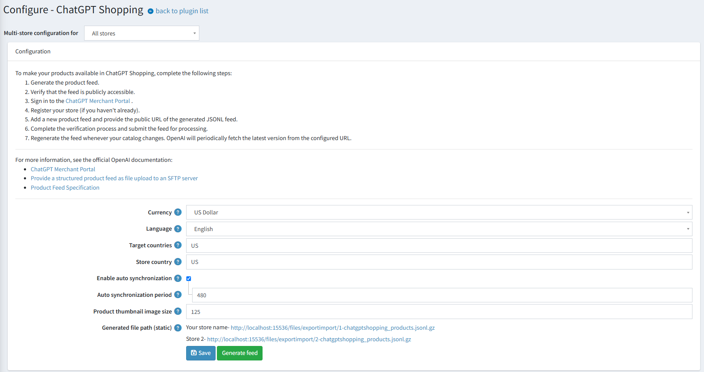

# ChatGPT shopping

ChatGPT Shopping makes your products discoverable in ChatGPT. The integration is implemented as the *ChatGPT Shopping* plugin (system name *Feed.ChatGptShopping*) and is available in nopCommerce 5.00.

The plugin generates a structured product feed that follows the OpenAI product feed specification, so ChatGPT accurately indexes and displays your products with up-to-date prices and availability. Your products will appear in AI-powered results when shoppers are actively exploring options, comparing products, and deciding what to buy. The feature works similarly to Google Shopping.

## How it works

- The plugin generates a product feed in the JSONL format (one product per line). The file is gzip-compressed and UTF-8 encoded.
- The feed file is generated for each store and stored at a static public URL, so it can be shared with the ChatGPT Shopping service.
- OpenAI periodically fetches the feed from the configured URL, keeping product data in ChatGPT up to date.
- The feed powers product discovery only: products are marked as eligible for search and ads, but not for checkout, so shoppers complete purchases on your store.

## Install the plugin

1. Go to **Configuration → Local plugins**.
1. Search for *ChatGPT Shopping* in the **Plugin name** field. The plugin belongs to the *Promotion feeds* group.
1. Click the **Install** button.
1. Click the **Restart application to apply changes** button to apply changes.

> [!NOTE]
>
> On installation, the plugin enables the **Use absolute image path** media setting (required for absolute product image URLs) and adds the *Synchronization (ChatGPT Shopping)* scheduled task, which is disabled by default.

## Configure the plugin

To configure the plugin, go to **Configuration → Local plugins** and click **Configure** beside *ChatGPT Shopping*.

This page enables multi-store configuration; it means that the same settings can be defined for all stores or differ from store to store. If you want to manage settings for a certain store, choose its name from the multi-store configuration dropdown list and select all the checkboxes needed on the left to set custom values for them. For further details, refer to [Multi-store](xref:en/getting-started/advanced-configuration/multi-store).

Define the following settings:

- **Currency** — the currency used to generate the feed. Product prices are converted to this currency.
- **Language** — the language used to generate the feed. Localized product names and descriptions are used.
- **Target countries** — the target countries for which the feed is generated. Use ISO 3166-1 alpha-2 country codes separated by commas (e.g., US,CA,GB). Omitted or empty does not mean worldwide.
- **Store country** — the store country. Use an ISO 3166-1 alpha-2 country code (e.g., US). Omitted or empty does not select another market.
- **Enable auto synchronization** — enable or disable automatic synchronization of the feed. If enabled, the feed is automatically synchronized at the specified interval.
- **Auto synchronization period** — the period (in minutes) for auto synchronization. It must be greater than 0 when auto synchronization is enabled.
- **Product thumbnail image size** — the default size (in pixels) for product thumbnail images in the feed.
- **Generated file path (static)** — the public URL of the generated feed file. The path is static for your store and can be shared with the ChatGPT Shopping service.

Click **Save** to save the changes. Use **Generate feed** to generate the feed manually.

## Generate the feed

Click the **Generate feed** button to generate the feed for the current store scope. If no specific store scope is selected, the feed is generated for all stores.

The feed includes products that are published, not deleted, and visible individually. Store mapping and access control lists (ACL) are taken into account.

The feed file is stored at `files/exportimport/{store ID}-chatgptshopping_products.jsonl.gz`. The public URL of each generated file is displayed in the **Generated file path (static)** field.

Each feed entry contains the following product data:

- **item_id** — the product SKU, unique per product. The GTIN and the manufacturer part number (MPN) are also submitted when specified.
- **title** — the product name (up to 150 characters).
- **description** — the full product description converted to plain text (up to 5,000 characters). The short description is used if the full description is empty.
- **url** — the product details page URL.
- **brand** — the manufacturer name.
- **product_category** — the category breadcrumb (e.g., Apparel & Accessories > Shoes).
- **condition** — the product condition (`new` by default).
- **image_url** and **additional_image_urls** — the main product image and additional images (up to 10 images in total), resized to the configured thumbnail size.
- **video_url** — the product video URL.
- **price** — the product price without discounts, in the `amount CURRENCY` format (e.g., `79.99 USD`), converted to the selected currency.
- **availability** — the stock status: `in_stock`, `out_of_stock`, or `pre_order`. Pre-order products also include the `availability_date`.
- **seller_name** and **seller_url** — your store name and store URL.
- **review_count** and **star_rating** — the number of approved product reviews and the average product rating.
- **target_countries** and **store_country** — the geo tagging data defined in the plugin settings.

## Automatic synchronization

To keep the feed up to date, the plugin adds the *Synchronization (ChatGPT Shopping)* scheduled task. By default, the task is disabled and runs every 8 hours (480 minutes) when enabled.

You can enable the task and specify the synchronization period in the plugin configuration. The task can also be managed in **System → Schedule tasks**. For further details, refer to [Schedule tasks](xref:en/running-your-store/system-administration/schedule-tasks).

> [!NOTE]
>
> Do not forget to restart the application once auto synchronization settings have been modified.

## Connect the feed to ChatGPT

To make your products available in ChatGPT Shopping, complete the following steps:

1. Generate the product feed.
1. Verify that the feed is publicly accessible.
1. Sign in to the [ChatGPT Merchant Portal](https://chatgpt.com/merchants/).
1. Register your store (if you haven't already).
1. Add a new product feed and provide the public URL of the generated JSONL feed.
1. Complete the verification process and submit the feed for processing.
1. Regenerate the feed whenever your catalog changes. OpenAI will periodically fetch the latest version from the configured URL.

For more information, see the official OpenAI documentation:

- [Power product discovery in ChatGPT](https://chatgpt.com/merchants/)
- [Provide a structured product feed as file upload to an SFTP server](https://developers.openai.com/commerce/specs/file-upload/overview)
- [Product feed specification](https://developers.openai.com/commerce/specs/file-upload/products).
