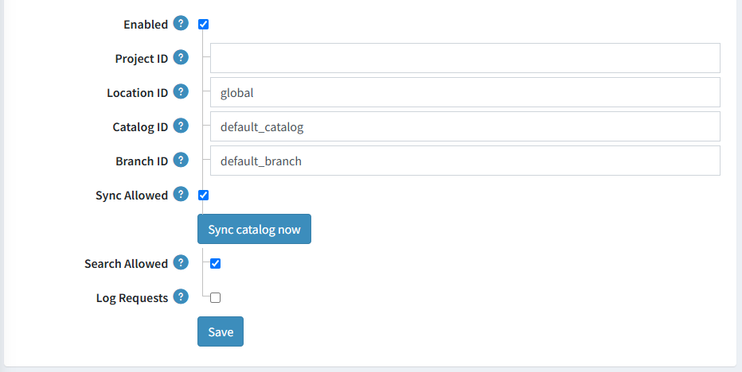

# Google AI Commerce Search

Google AI Commerce Search is Google's AI-powered product discovery service. It understands what a shopper is actually looking for and returns the most relevant products from your catalog, which improves search relevance and, as a result, conversions and average order value.

In nopCommerce, the integration is implemented as the *Google AI Commerce Search* plugin (system name *AIRecommendation.GoogleAI*), available since nopCommerce 5.00. The plugin belongs to the *AI-powered recommendation* group.

## How it works

- The plugin imports your product catalog into a Google Cloud catalog (project → location → catalog → branch) through the Retail API.
- Once the data is imported, Google builds and indexes the catalog, and the search engine returns product IDs ranked by relevance for the entered keywords.
- Product changes made in nopCommerce are sent to Google immediately, so the index stays up to date without manual re-imports.
- Search results returned by Google are mapped back to nopCommerce products. nopCommerce re-applies its own restrictions (published products, availability dates, store mapping, access control lists, price range) and displays the products in the order returned by Google, so shoppers see Google ranking on top of standard nopCommerce search.
- Categories, manufacturers, product tags, and specification attribute filters selected by a shopper are passed to Google as search filters, so filtering is applied by the search engine itself.
- Google uses the visitor ID to personalize and re-rank results. The plugin passes the value of the `_ga` cookie (Google Analytics) as the visitor ID, therefore the [Google Analytics](xref:en/getting-started/advanced-configuration/configure-analytics) plugin is required.

> [!NOTE]
>
> The AI-powered recommendation provider is used for keyword-based product search only, i.e., the autocomplete dropdown of the search box and the search results page. Other product lists are not affected.

## Prerequisites

Before you install the plugin, prepare the Google Cloud side of the integration:

1. Enable the Retail API for your Google Cloud project.
1. Create a catalog with a default branch (the plugin works with a single catalog and branch).
1. Create a service account and grant it the role required to work with the Retail API (*Retail Editor* is enough for the full synchronization; *Retail Viewer* can be used if the catalog is imported by another tool, e.g. BigQuery).
1. Create a JSON key for the service account and download it.

### Authorize nopCommerce

Authorization is handled by [Identity and Access Management (IAM)](https://docs.cloud.google.com/iam/docs/overview) and the plugin supports [Application Default Credentials (ADC)](https://docs.cloud.google.com/docs/authentication/application-default-credentials), which allows the same code to run in development and production environments. The most reliable way to configure ADC for this integration is to use a service account key.

Copy the downloaded JSON key file to your server (for example, to the `/etc/gcloud/` directory) and point the `GOOGLE_APPLICATION_CREDENTIALS` environment variable to it:

- Linux (terminal or the `.bashrc` startup script):

  ```sh
  export GOOGLE_APPLICATION_CREDENTIALS="/etc/gcloud/your-service-account-key.json"
  ```

- Windows (PowerShell, machine scope):

  ```powershell
  [System.Environment]::SetEnvironmentVariable('GOOGLE_APPLICATION_CREDENTIALS', 'C:\gcloud\your-service-account-key.json', 'Machine')
  ```

- Docker (pass the variable and mount the key file):

  ```sh
  docker run -e GOOGLE_APPLICATION_CREDENTIALS=/app/key.json -v /etc/gcloud/your-service-account-key.json:/app/key.json my-retail-app
  ```

Restart the application afterwards, so the new environment variable is picked up.

## Install the plugin

1. Go to **Configuration → Local plugins**.
1. Search for *Google AI Commerce Search* in the **Plugin name** field. The plugin belongs to the *AI-powered recommendation* group and requires the *Google Analytics* plugin.
1. Click the **Install** button.
1. Click the **Restart application to apply changes** button to apply changes.
1. On the plugin details page, select the **Enabled** checkbox to make the plugin the active AI-powered recommendation provider. Only one AI-powered recommendation provider can be active at a time.

> [!NOTE]
>
> On installation, the plugin enables the **Use absolute image path** media setting, which is required to pass absolute product image URLs to Google, and it fills the default values for the configuration: *global* location, *default_catalog* catalog, and *default_branch* branch.

## Configure the plugin

To configure the plugin, go to **Configuration → Local plugins** and click **Configure** beside *Google AI Commerce Search*.



The configuration page describes how Google Cloud authorization works and provides the following settings:

- **Enabled** — enable or disable the plugin. When disabled, the plugin neither synchronizes data with Google nor returns search results.
- **Project ID** — the Google Cloud project ID that owns the catalog.
- **Location ID** — the Google Cloud location (region) ID of the catalog, for example `global`.
- **Catalog ID** — the Google Cloud catalog ID.
- **Branch ID** — the Google Cloud branch ID that receives the product data.
- **Sync Allowed** — enable or disable synchronization of product data with Google. Disable it if your catalog is imported by another tool (for example, BigQuery) or if you only want to use Google for search.
- **Search Allowed** — enable or disable searching products through Google.
- **Log Requests** — enable or disable logging of the requests sent to Google. Useful for debugging and testing; the requests are written to the nopCommerce log file.

All four identifiers (project, location, catalog, and branch) are required and must match the values in the Google Cloud console.

Click **Save** to save the changes.

## Import the catalog

To import the whole catalog into Google, click the **Sync catalog now** button. You need to enable the **Sync Allowed** setting and grant the *Edit products* permission to run this action.

The plugin converts the products and imports them in batches (500 products per request), then displays a notification with the number of successfully imported products and the number of failures. The import result is also written to the nopCommerce log.

Only published products are imported, and store mapping and access control lists are taken into account.

Each product is submitted with the following data:

- **ID** — the product SKU, or the product ID when the SKU is empty.
- **Type** — *Primary* for regular products and *Variant* for product attribute combinations and grouped product variants.
- **Primary product ID** — the SKU (or ID) of the parent product for variants.
- **Name**, **GTIN**, **URL**, **language code** — the language code of the default admin language is used.
- **Title** — the product short description (up to 1,000 characters).
- **Description** — the product full description (up to 5,000 characters).
- **Price** — the product price (the overridden price for a variant) in the primary store currency.
- **Availability** — `IN_STOCK`, `OUT_OF_STOCK`, or `BACKORDER`, calculated depending on the inventory management method and the stock quantity.
- **Rating** — the average rating and the number of approved product reviews.
- **Categories** — the full category path (e.g., `Sports & Fitness > Athletic Clothing > Shoes`). Full paths are strongly recommended by Google for better search and recommendation quality.
- **Brands** — manufacturer names.
- **Attributes** — specification attributes and their option names.
- **Tags** — product tags.
- **Images** — the product image; the first combination image is used for variants.

## Synchronize product changes

When both the **Enabled** and **Sync Allowed** settings are enabled and the plugin is the active AI-powered recommendation provider, the plugin keeps Google up to date automatically:

- a product or a product attribute combination that is created is sent to Google;
- a product or a product attribute combination that is updated is updated in Google;
- a product or a product attribute combination that is deleted is removed from Google.

If these settings are disabled or another AI-powered recommendation provider is active, no requests are sent, and you can rely on the full catalog import instead.

## Search on the public store

When both the **Enabled** and **Search Allowed** settings are enabled, keyword-based product search on the public store is served by Google:

- The keywords entered by a shopper are sent to the `default_search` placement of the configured catalog and branch.
- Category, manufacturer, product tag, and specification attribute filters are converted into the Retail API filter syntax.
- The visitor ID is taken from the `_ga` cookie, so results can be personalized. Make sure the Google Analytics plugin is installed and configured and that its cookie is not blocked for your store.
- The search page size is limited to 120 products per request (the maximum allowed by the Retail API).
- The returned product IDs or SKUs are mapped back to nopCommerce products; duplicate entries (for example, several variants of the same product) are reduced to a single product.
- If Google returns no products for the entered keywords or the request fails, nopCommerce falls back to the standard product search, so shoppers still get results.

> [!IMPORTANT]
>
> Google returns results only for products that are already imported into the catalog and indexed. Run **Sync catalog now** after the initial configuration, and keep the catalog synchronized, otherwise shoppers may get no AI-powered results.

## Troubleshooting

- **No search results** — make sure the catalog has been imported, the **Enabled** and **Search Allowed** settings are enabled, and the plugin is the active AI-powered recommendation provider. Keep in mind that nopCommerce falls back to the standard search when Google returns nothing.
- **Authentication errors** — verify that the `GOOGLE_APPLICATION_CREDENTIALS` environment variable is set for the account that runs the application, that the key file is readable, and that the application has been restarted after the variable was changed.
- **Permission denied errors** — make sure the service account has the required Retail API role and that the Retail API is enabled for the project.
- **Empty or irrelevant results** — improve the source data: full category paths, product tags, specification attributes, images, prices, and availability all influence ranking.
- **Debugging** — enable the **Log Requests** setting and check the nopCommerce log for the requests sent to Google.

## Further reading

- [AI Commerce Search overview](https://cloud.google.com/retail/docs)
- [How it works](https://cloud.google.com/retail/docs/how-it-works)
- [Import products](https://cloud.google.com/retail/docs/import/products)
- [Filter and order results](https://cloud.google.com/retail/docs/filter-and-order)
- [Search API reference](https://cloud.google.com/retail/docs/reference/rpc/google.cloud.retail.v2#google.cloud.retail.v2.SearchRequest)
- [Access control for the Retail API](https://cloud.google.com/retail/docs/access-control)
