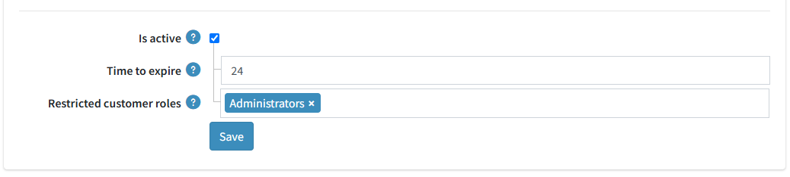
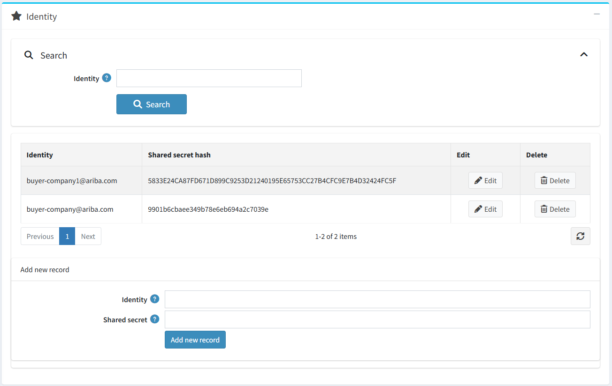
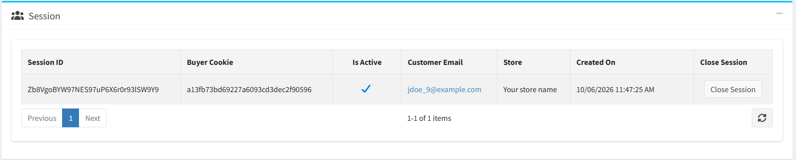
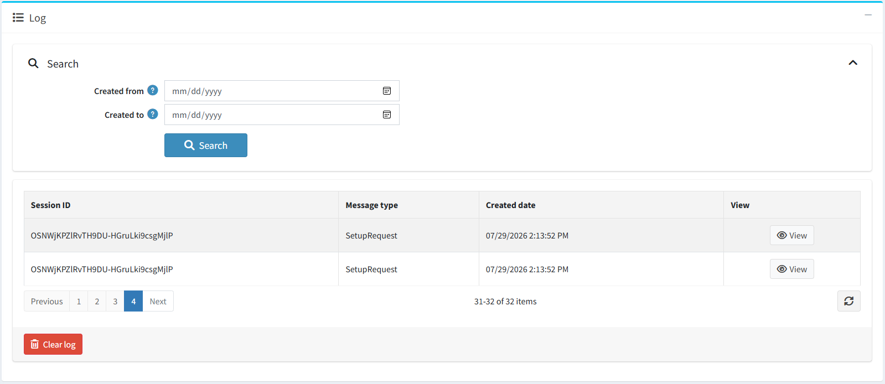

# PunchOut

PunchOut is a procurement protocol that seamlessly connects your store to enterprise buyer procurement systems, such as SAP Ariba, Coupa, Oracle eProcurement, and more. It allows buyers to access your store directly from their procurement system, browse the catalog, and add products to the shopping cart without leaving their purchasing workflow. The cart content is then transferred back to the procurement system as a requisition.

In nopCommerce, the integration is implemented as the *PunchOut cXML Integration* plugin (system name *Misc.PunchOut*) and is available since nopCommerce 5.00. The plugin belongs to the *Misc* group and implements the PunchOut protocol using cXML (version 1.2.014).

## How it works

1. A procurement system sends a `PunchOutSetupRequest` (cXML document) to your store.
1. nopCommerce validates the request, creates a PunchOut session, and returns a `PunchOutSetupResponse` containing the Start Page URL.
1. The user is redirected from the procurement system to the nopCommerce storefront and is automatically authenticated.
1. The user browses the catalog and adds products to the shopping cart as usual.
1. During an active PunchOut session, the standard **Checkout** button is replaced with **Submit for Approval**.
1. When **Submit for Approval** is clicked, nopCommerce generates a `PunchOutOrderMessage` (cXML) from the current shopping cart.
1. The browser automatically posts the `PunchOutOrderMessage` back to the procurement system using the *BrowserFormPost* URL provided in the original setup request.
1. The procurement system creates or updates the requisition based on the received cart data.
1. No order is created in nopCommerce, and payment processing is skipped.
1. The PunchOut session is completed and the user is returned to the procurement system.

> [!NOTE]
>
> - PunchOut sessions are stored in the database and expire automatically.
> - All inbound and outbound cXML documents are logged for auditing and troubleshooting.
> - Multiple procurement systems can be configured using separate PunchOut client credentials.
> - The standard nopCommerce checkout flow is bypassed for active PunchOut sessions.

## Install the plugin

1. Go to **Configuration → Local plugins**.
1. Search for *PunchOut cXML Integration* in the **Plugin name** field. The plugin belongs to the *Misc* group.
1. Click the **Install** button.
1. Click the **Restart application to apply changes** button to apply changes.

## Configure the plugin

To configure the plugin, go to **Configuration → Local plugins** and click **Configure** beside *PunchOut cXML Integration*.

The configuration page contains the following sections:

- **Common settings** — general plugin settings.
- **Identity** — the PunchOut client credentials allowed to connect to your store.
- **Session** — the active and completed PunchOut sessions.
- **Log** — the inbound and outbound cXML documents.

Define the following general settings:

- **Is active** — enable or disable the plugin. The plugin is disabled by default; when it is disabled, nopCommerce responds to incoming setup requests with the *Service Unavailable* error.
- **Time to expire** — the time in hours after which the PunchOut session will expire (24 hours by default).
- **Restricted customer roles** — select customer roles that will not have access to the PunchOut feature. If no role is selected, all customers will have access. By default, the *Administrators* role is restricted.

Click **Save** to save the changes.

## Configure identities

A procurement system authenticates itself by the *Identity* and *Shared secret* credentials sent in the `Sender` element of the setup request. nopCommerce validates the credentials and rejects requests with an invalid shared secret.

In the **Identity** section, manage the senders allowed to connect to your store:

- Use the search field to filter identities by the identity value.
- The grid lists the **Identity** and **Shared secret hash** columns. Both values can be edited inline.
- Use the **Edit** and **Delete** buttons to manage the identities.
- In the *Add new record* block, enter the **Identity** and **Shared secret** of the procurement system and click the **Add new record** button.

> [!IMPORTANT]
>
> The shared secret is stored as a SHA-256 hash. Provide the identity and shared secret to your procurement system administrator, so the same credentials can be configured on the procurement system side.

## The PunchOut session on the storefront

When a buyer follows the Start Page URL, nopCommerce activates the session and signs the buyer in automatically. If a customer with the contact email from the setup request does not exist, a new customer is created and assigned to the *Registered* customer role. The *ShipTo* address from the setup request is saved as the customer's shipping address.

During an active PunchOut session:

- The buyer can browse the home page, catalog, product pages, and the shopping cart only; navigation to any other page is redirected to the home page.
- The standard **Checkout** button is replaced with **Submit for Approval**, and item discounts are hidden on the cart page.
- Checkout, contact forms, product reviews, and customer account pages (account information, registration, password recovery, addresses, downloadable products, avatar, GDPR tools, gift card balance, multi-factor authentication) are not available.
- Product reviews are disabled on product details pages.

If the session expires, the session data is cleared and the buyer is redirected to the home page with the *Your PunchOut session has expired* notification.

## Manage sessions

The **Session** section lists PunchOut sessions with the session ID, buyer cookie, activity state, customer email (linked to the customer edit page), store, and creation date. Use the **Close Session** button to close a session manually.

## View the log

The **Log** section lists all inbound and outbound cXML documents. Each entry contains the session ID, message type (*SetupRequest*, *SetupResponse*, or *OrderMessage*), and creation date. Filter the log by the creation date.

Click the **View** button to see the entry details: session ID, message type, direction (*Inbound* — from the procurement system to nopCommerce, or *Outbound* — from nopCommerce to the procurement system), raw XML, URL, identity, error message (if any), and creation date. Delete single entries on the log entry page, or clear the whole log using the **Clear log** button.

## cXML messages

The plugin implements the following cXML messages (version 1.2.014):

- **PunchOutSetupRequest** — sent by the procurement system to `POST /punchout/setup`. nopCommerce reads the sender credentials, buyer cookie, *BrowserFormPost* URL, contact email, and *ShipTo* address.
- **PunchOutSetupResponse** — returned by nopCommerce. It contains the Start Page URL (`/punchout/start?sessionId=...`) that redirects the buyer to the storefront.
- **PunchOutOrderMessage** — generated from the current shopping cart and posted to the *BrowserFormPost* URL. It contains the buyer cookie, the cart total, and the cart items with the product SKU (`SupplierPartID`), description (the product name and attribute values), quantity, unit price, and currency.

Error responses use the standard cXML `Response/Status` element with the appropriate status code: `401` for an invalid shared secret, `400` for a malformed request, and `503` when the plugin is disabled.

## Further reading

- [Getting Started with cXML (PDF)](https://xml.cxml.org/current/cXMLGettingStarted.pdf)
- [cXML Reference Guide (PDF)](https://xml.cxml.org/current/cXMLReferenceGuide.pdf)
- [cXML 1.2.014 DTD](http://xml.cxml.org/schemas/cXML/1.2.014/cXML.dtd)
