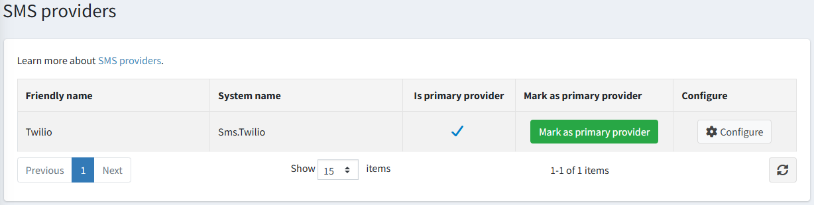

# SMS providers

To define SMS providers go to **Configuration → SMS providers**.

Only one SMS provider can be used for sending notifications. Adding new SMS providers is only recommended for advanced users.
To select the default SMS provider click the **Mark as primary provider** button.

## Enable sign-in with phone number

1. Go to **Configuration → Settings → Customer settings**. [Password and security](xref:en/running-your-store/customer-management/customer-settings) section.
2. Select the **'Login by phone' enabled** checkbox (an additional option to sign in by email address).
3. Make sure the **'Phone number' enabled** option is selected in the *Customer form fields* panel, otherwise customers will not be able to specify the number to send the code to.
4. Save the settings.

## How it works

1. A customer enters the phone number on the sign-in page of the public store.
2. The store asks the primary SMS provider (Twilio in this case) to send a verification code to this number.
3. The customer enters the received code, and the store verifies it before signing the customer in.

> [!TIP]
>
> By default, there are several SMS providers available in nopCommerce, but you can find more SMS providers in the nopCommerce [marketplace](https://www.nopcommerce.com/marketplace).

The configuration of SMS providers is described in the following chapters:

* [Twilio SMS provider](xref:en/getting-started/advanced-configuration/sms-providers/twilio)
