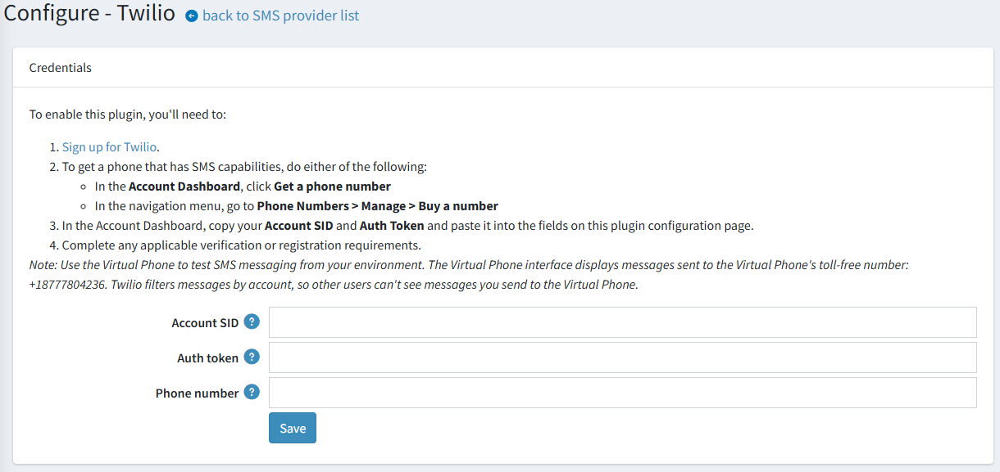

# Twilio SMS provider

[Twilio](https://www.twilio.com/) is a cloud communication platform with programmable SMS sending. nopCommerce supports Twilio out of the box, so no third-party plugin is required.

In nopCommerce, the SMS provider is used to send a **one-time verification code (OTP)** when a customer signs in to the store with a phone number. This option is additional: customers can continue to sign in with an email address or a username.

## Twilio account

The provider works over the Twilio REST API, so a Twilio account is required:

1. Sign up for a Twilio account and complete the verification in the [Twilio Console](https://console.twilio.com/).
2. Get a phone number that supports SMS. In the **Account Dashboard**, click **Get a phone number**, or go to **Phone Numbers → Manage → Buy a number** and make sure the number has the **SMS** capability enabled.
3. Copy the account credentials from the **Account Dashboard**:
    * **Account SID** — a 34-character identifier that begins with "AC". It acts as a login and identifies the account (or subaccount) the messages are sent from.
    * **Auth token** — the key used to authorize API requests.

> [!IMPORTANT]
>
> Sending SMS requires a positive balance on the Twilio account. Messages are charged per segment, and the rates depend on the destination country.
>
> [!NOTE]
>
> Some countries and networks require additional procedures (sender registration, short code approval, and so on) before commercial messages can be delivered. Complete all the applicable verification or registration requirements for the countries your customers are in.

## Configure the provider

1. Go to **Configuration → SMS providers**.
2. Find the **Twilio SMS provider** entry in the list and click **Mark as primary provider** to make nopCommerce use it for sending SMS. Only one provider can be used at a time.

    > [!NOTE]
    >
    > If another provider was used before, its primary status is removed automatically.

3. Click **Configure** beside the Twilio SMS provider option in the list to open the credentials page.

    

4. Fill in the following fields:

    * **Balance info**: the current balance of your Twilio account. This field is read-only and is displayed after the provider is configured. Click **Check the account balance** to update the value.
    * **Account SID**: the **Account SID** copied from the **Account Dashboard** of the Twilio Console.
    * **Auth token**: the **Auth token** copied from the **Account Info** pane of the **Console Dashboard** page. Treat it as a password: it grants full access to the account.
    * **Phone number**: the Twilio account phone number the verification codes are sent from. Enter the number in the international format, for example `+12345678900`.

5. Click **Save**.

> [!TIP]
>
> Twilio filters messages by account, so you can test the sending without using a real mobile number: send a message to the Twilio **Virtual Phone** number `+18777804236` and check the message in the Virtual Phone interface. Note that only messages sent from your account are displayed there.

## Troubleshooting

If customers do not receive the verification code, check the following:

* The **Account SID**, **Auth token**, and **Phone number** values are copied correctly and contain no extra spaces.
* The **Balance info** field shows a positive balance, since verification codes are not sent when the account is exhausted.
* The sender number is SMS-capable, and the verification or registration requirements for the destination country are completed.
* The recipient number is specified in the international format, for example `+12345678900`.
* The details of the failed requests and the final delivery status are available in the Twilio Console (**Message → Logs**).

> [!NOTE]
>
> A successful response from the Twilio API means the message was accepted for sending, not that it was delivered. Always check the message log in the Twilio Console for the final status.
