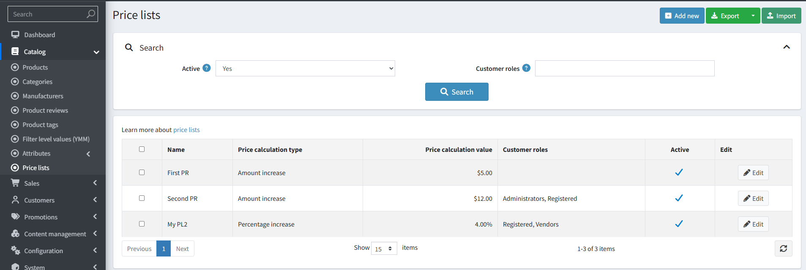
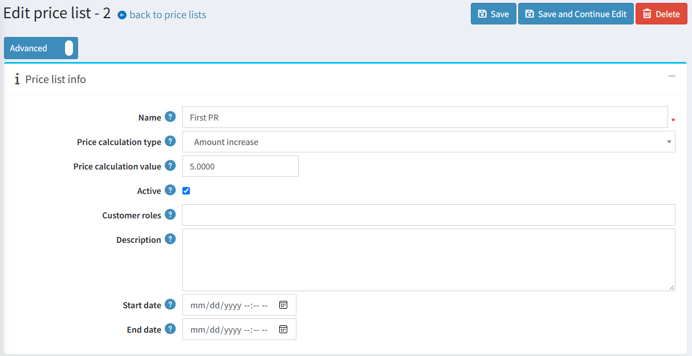
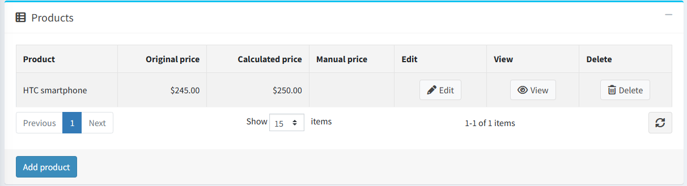
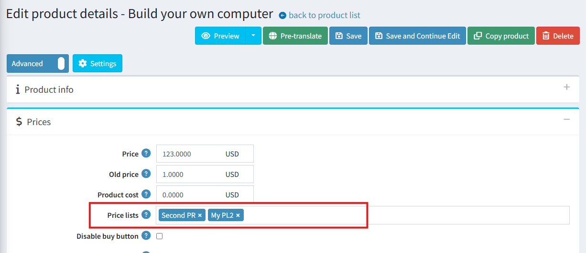
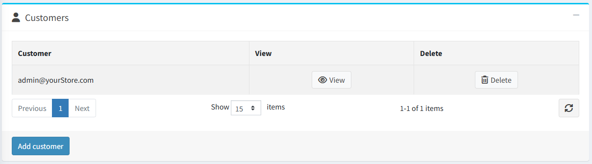

# Price lists

## Overview

A price list is a named set of rules that changes the price of the products assigned to it. A price list can raise or lower the base product price by a percentage or a fixed amount, or set one fixed price for all its products, for example:

- wholesale or B2B prices for a specific customer role;
- a temporary sale applied to a selected customer group for a limited period;
- negotiated prices for particular customers, such as a long-term contract customer.

Price lists differ from [discounts](xref:en/running-your-store/promotional-tools/discounts) in that a price list changes the product price itself, and thus becomes the base for further calculations, while a discount is applied on top of the resulting price.

## How a price list affects the price

A price is taken from a price list only when all the following conditions are met:

- the price list is **active**;
- the current moment is within the price list's start and end dates (if specified);
- the customer belongs to the customer roles selected for this price list, or is one of the customers added to this price list individually;
- the product is assigned to this price list.

The price list price is calculated from the product base **Price** value using the selected calculation type and value:

| Calculation type | Result |
| --- | --- |
| Percentage decrease | base price minus the specified percentage |
| Percentage increase | base price plus the specified percentage |
| Amount decrease | base price minus the specified amount |
| Amount increase | base price plus the specified amount |
| Fixed price | the specified price is used as is |

For example, for a product with a base price of $100 and a price list with the *Percentage decrease* type and a value of 15, the price becomes $85.

A product can have a **Manual price** set within a price list. When specified, this value is used instead of the calculated one.

> [!NOTE]
>
> For any product you can check the result of the calculations on the price list's *Products* panel, where the **Original price**, **Calculated price**, and **Manual price** columns are displayed.

### Multiple price lists for one product

If several active price lists apply to the same product and customer, the result depends on the **Price list strategy** setting, which you can find in **Configuration → Settings → Catalog settings**.

- **Minimal price**: all applicable price lists are applied, and the lowest resulting price is used.
- **Use by priority**: price lists are applied in ascending order of their **Priority** value, and the price of the first applicable price list is used. Price lists with a lower priority value are applied first; if several price lists share the same value, they are applied in the order they were created. This field is only displayed in the admin area when the *Use by priority* strategy is selected.

> [!NOTE]
>
> The setting can also be configured separately for each store in a multi-store installation.

## Creating a price list

To add a new price list, go to **Catalog → Price lists** and click **Add new**.

Define the following values in the *Price list info* panel:

- **Name** of the price list.
- **Price calculation type**. The available options are *Percentage decrease*, *Percentage increase*, *Amount decrease*, *Amount increase*, and *Fixed price*.
- **Price calculation value**. Its meaning depends on the selected calculation type: a percentage for the percentage types, or an amount for the amount and fixed price types.
- **Active**. Inactive price lists are not applied to products, which allows you to prepare a list in advance and switch it on later.
- **Customer roles**. Select the roles to which this price list is applied. If no role is selected, and no individual customers are added, the price list is applied to all customers.
- **Description** of the price list.
- **Start date** and **End date**. Leave these fields empty to make the price list active indefinitely.

Click **Save** to save the changes, or **Save and continue edit** to proceed to the other panels.

## Assigning products to a price list

Products can be added to a price list from the price list page or from the product page.

### From the price list page

Go to the *Products* panel of the price list and click **Add product**. In the pop-up window, find the required products (you can search by product name, category, manufacturer, vendor, store, and product type), select them, and click **Save**.

For each product in the grid, you can:

- view the **Original price** (the product's base price) and the **Calculated price**;
- set the **Manual price** to override the calculated value. Click **Edit**, enter the price, and save;
- open the product page or remove the product from the price list.

### From the product page

Go to **Catalog → Products**, open the required product, and in the *Price* panel select the price lists in the **Price lists** field. For more details, see [Add products](xref:en/running-your-store/catalog/products/add-products).

> [!NOTE]
>
> A manual price set on the price list's *Products* panel takes precedence over the price calculated by the price list. Read more about this field in the [Add products](xref:en/running-your-store/catalog/products/add-products) section.

## Assigning customers to a price list

Along with customer roles, you can assign a price list to specific customers. Go to the *Customers* panel of the price list and click **Add customer**. Find the required customers, select them, and click **Save**.

The price list is then applied to these customers in addition to the customers with the selected roles.

> [!NOTE]
>
> Only registered customers can be added to a price list this way. To apply a price list to guests, use customer roles, such as the *Guests* role.

## Import and export price lists

On the **Catalog → Price lists** page, you can import price lists from an Excel file or export the existing ones.

To export, click **Export** and select **Export to Excel (all found)** or **Export to Excel (selected)**. To import, click **Import** and upload the Excel file.

The file contains the following columns for each price list:

`Id`, `Name`, `Description`, `Active`, `StartDateUtc`, `EndDateUtc`, `PriceCalculationType`, `PriceCalculationValue`, `Customers`, `CustomerRoles`, `Priority`.

Each product of a price list is described in the nested rows of the same file, with the `Sku` and `ManualPrice` columns.

> [!NOTE]
>
> Price lists are distinguished by the **Id** column. If an ID already exists in your store, the corresponding price list is updated; for new price lists, leave this column set to 0. All the SKUs specified in the file must exist in your catalog, otherwise the import is not performed.

## Permissions

The price list functionality is controlled by the following permissions in **Configuration → Users → Roles**:

- **View price lists**.
- **Create, edit and delete price lists**.
- **Import and export price lists**.

Read more about how to configure permissions in the [Access control list](xref:en/running-your-store/customer-management/access-control-list) section.

## See also

- [Add products](xref:en/running-your-store/catalog/products/add-products)
- [Tier prices](xref:en/running-your-store/promotional-tools/tier-prices)
- [Discounts](xref:en/running-your-store/promotional-tools/discounts)
- [Customer roles](xref:en/running-your-store/customer-management/customer-roles)
- [Multi-store functionality](xref:en/getting-started/advanced-configuration/multi-store)
