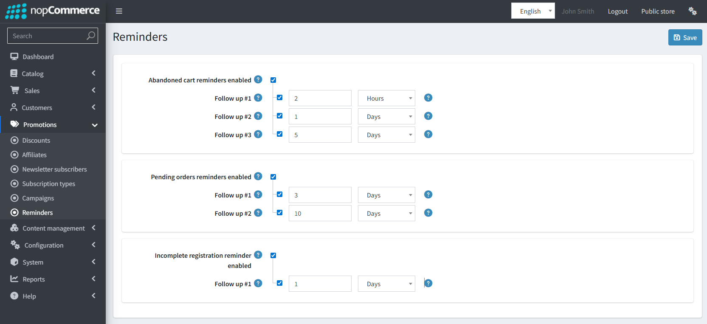
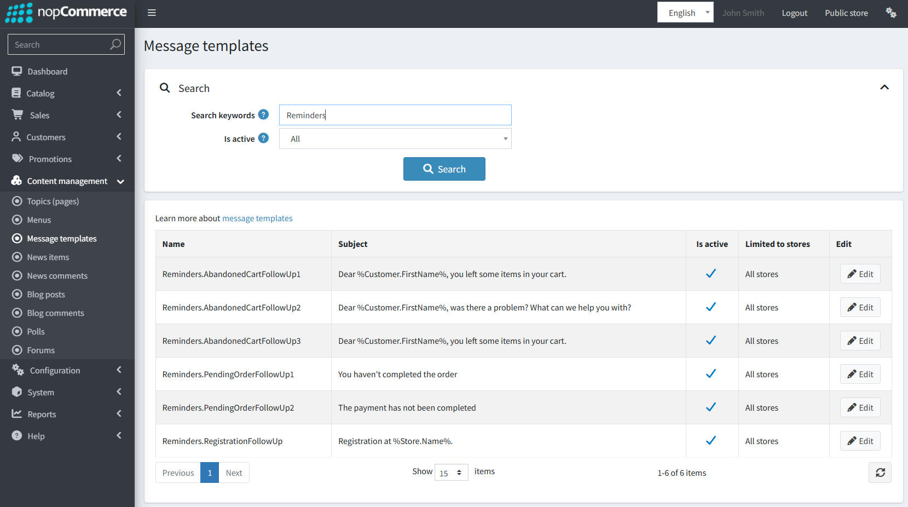
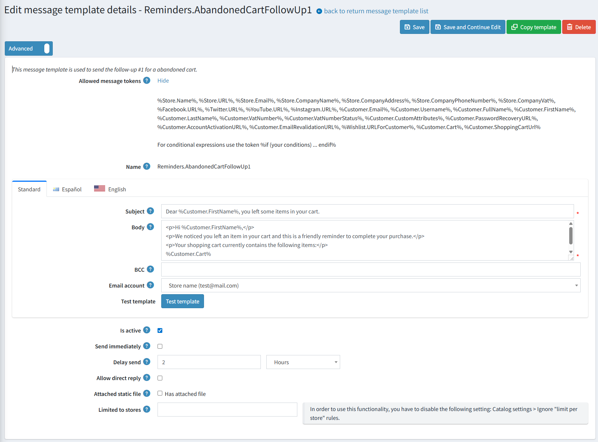
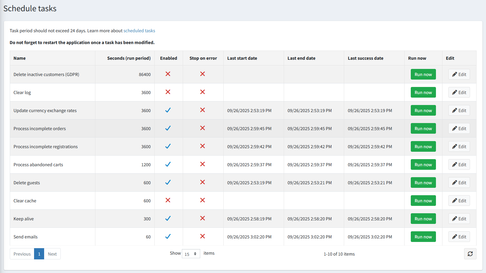

# Reminders

The **Reminders** feature allows sending email notifications to users about their abandoned carts, incomplete registrations, and unfinished orders. This functionality helps improve user engagement and conversion by reminding users to complete their actions.

## Available Reminders

There are three types of reminders that can be sent to users:

1. **Abandoned Cart**
   - Up to **3 reminders** can be sent for an abandoned cart.
   - Reminders are sent sequentially based on the time of the user's last interaction with the cart.
   - A reminder is sent only if the delay configured for that reminder has passed since the last interaction.

1. **Abandoned Order**
   - Up to **2 reminders** are sent, but only for the **earliest incomplete order**.
   - If a reminder has been sent for an order, reminders for other orders are not sent until the current order is completed.

1. **Incomplete Registration**
   - Only **one reminder** is sent.
   - This reminder is triggered only for users whose **Registration Method** is set to *"Email validation is required after registration"*.

> [!Note]
> All reminders starting from the second one are sent only if the previous reminder has already been sent.

## Administration

Administrators can manage reminders in the **Reminders** page under the **Promotions** section:

- Reminders can be enabled or disabled for the entire group or individually.
- Each reminder has a configurable **delay**, which determines when the reminder will be sent.
- Each reminder is associated with a **Message Template**.

    

- And the delay directly affects the **Delay Send** setting in the template.

    

## Tokens for Cart Reminders

Two tokens are available for cart reminders:

- `%Customer.Cart%` – Inserts a table of products from the user's cart.
- `%Customer.ShoppingCartUrl%` – URL linking directly to the user's cart (including login if required).

## Scheduled Tasks

Each type of reminder is handled by a scheduled task:

- **Process incomplete registrations** – runs **hourly**.
- **Process incomplete orders** – runs **hourly**.
- **Process abandoned carts** – runs **every 20 minutes**.

These tasks ensure timely processing and sending of reminders according to the configured delays.

